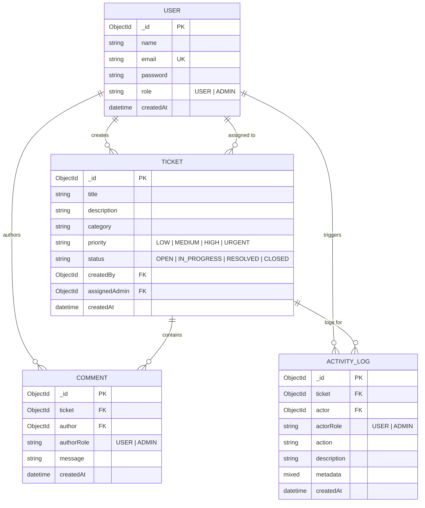

# QuickDesk - Support Ticket Management System

A web-based support ticketing system built with Node.js, Express, MongoDB (Mongoose), and React (Vite, Tailwind CSS). The application supports user authentication, role-based access control, ticket lifecycle workflows, comment threads, and an event-driven activity logging system using Node.js `EventEmitter`.

---

## Table of Contents

1. [Features](#features)
2. [Technology Stack](#technology-stack)
3. [Architecture](#architecture)
4. [Database Design](#database-design)
5. [Event-Driven Architecture & Activity Logging](#event-driven-architecture--activity-logging)
6. [Security & Authorization](#security--authorization)
7. [API Reference](#api-reference)
8. [Setup and Installation](#setup-and-installation)
9. [Automated Testing](#automated-testing)
10. [Key Technical Decisions](#key-technical-decisions)

---

## Features

### User (Customer)
- Register, log in, and view authenticated profile.
- Create support tickets with category and priority.
- View and search personal tickets with multi-criteria filters (Status, Priority, Category).
- Edit and delete tickets while status is `OPEN`.
- Post and read comments on owned tickets in chronological order.

### Administrator
- Operations dashboard with live ticket metrics (total, open, in progress, resolved, high priority).
- View, search, and filter all submitted tickets across all users.
- Update ticket status (`OPEN`, `IN_PROGRESS`, `RESOLVED`, `CLOSED`) and priority (`LOW`, `MEDIUM`, `HIGH`, `URGENT`).
- Assign administrators to tickets.
- Post official responses to any ticket.
- View ticket activity history and full system event audit logs.

---

## Technology Stack

- **Backend**: Node.js, Express.js (ES Modules), REST APIs
- **Database**: MongoDB with Mongoose ODM
- **Frontend**: React, Vite, Tailwind CSS, Lucide React, Axios, React Router
- **Authentication**: JSON Web Tokens (JWT), bcryptjs, cookie-parser
- **Security & Utilities**: Helmet, CORS, Morgan, express-validator, dotenv
- **Testing**: Node.js Test Runner, Supertest, mongodb-memory-server

---

## Architecture

The backend follows a layered MVC-inspired architecture:

```
backend/
├── src/
│   ├── config/          # MongoDB connection
│   ├── models/          # Mongoose models (User, Ticket, Comment, ActivityLog)
│   ├── validators/      # express-validator schemas
│   ├── middleware/      # Authentication, role authorization, error handling
│   ├── events/          # EventEmitter and async event listeners
│   ├── services/        # Business logic and domain rules
│   ├── controllers/     # HTTP handlers
│   ├── routes/          # Express route definitions
│   ├── utils/           # Helper functions (token generation, responses)
│   ├── app.js           # Express app setup
│   └── server.js        # Server entry point
├── scripts/             # Seed scripts
└── tests/               # Integration tests
```

---

## Database Design

### Why Separate Collections Instead of Document Embedding
1. **Unbounded Growth**: High-activity tickets can accumulate many comments and status changes over time. Storing comments or logs embedded inside the ticket document risks hitting MongoDB's 16MB document limit and creates frequent document reallocations.
2. **Audit Immutability**: Activity logs are immutable records. Storing them in a separate collection allows them to be queried, indexed, and retained independently.
3. **Efficient Indexing & Pagination**: Separate collections allow cursor/skip-based pagination on comments and logs without loading large parent ticket documents.

### Schemas



### Key Indexes
- `Ticket`: `{ createdBy: 1, createdAt: -1 }` (user ticket lookups)
- `Ticket`: `{ status: 1, priority: 1, createdAt: -1 }` (admin filtering)
- `Ticket`: `{ title: 'text', description: 'text' }` (search queries)
- `Comment`: `{ ticket: 1, createdAt: 1 }` (chronological comment loading)
- `ActivityLog`: `{ ticket: 1, createdAt: -1 }` (ticket activity timeline)
- `ActivityLog`: `{ createdAt: -1 }` (global activity feed)

---

## Event-Driven Architecture & Activity Logging

When key operations occur, domain services emit lifecycle events via Node's `EventEmitter`:

- `TICKET_CREATED`: Emitted when a ticket is created.
- `TICKET_UPDATED`: Emitted when title, description, or category is modified.
- `STATUS_CHANGED`: Emitted on ticket status transitions (if transitioning to `RESOLVED`, also triggers `TICKET_RESOLVED`).
- `PRIORITY_CHANGED`: Emitted when priority is updated.
- `COMMENT_ADDED`: Emitted when a comment is posted.
- `TICKET_RESOLVED`: Emitted on resolution.
- `TICKET_DELETED`: Emitted when an open ticket is deleted.

### Reliability & Design Considerations
- **Non-blocking logging**: The event listeners in `eventListeners.js` write activity logs asynchronously, decoupled from controller response cycles.
- **Error containment**: Event handlers are wrapped in individual `try/catch` blocks so an activity log failure does not fail or rollback the primary HTTP request.
- **Trade-offs**: In-process `EventEmitter` is lightweight and requires no external infrastructure. However, events are held in memory; if the process crashes before an event is handled, it is not retried. For larger distributed environments, replacing the in-process emitter with a message broker (e.g. Redis Streams, RabbitMQ, Kafka) using an outbox pattern would provide persistence and retry guarantees.

---

## Security & Authorization

1. **HTTP-Only Cookies**: JWT tokens are issued in HTTP-only, SameSite cookies to protect against token theft via client-side XSS. Authorization headers (`Bearer <token>`) are also supported for API testing and automation.
2. **Password Hashing**: Passwords are hashed using `bcryptjs` with 10 salt rounds in a Mongoose `pre('save')` hook. Passwords are set to `select: false` so hashes are never returned by default.
3. **Role Escalation Prevention**: Registration validation enforces `role: 'USER'`, blocking any attempt to supply elevated roles via request payloads.
4. **Ownership Verification**:
   - Non-admin users cannot access or view tickets owned by other users.
   - Non-admin users cannot read or post comments on tickets they do not own.
   - Ticket edits and deletions are permitted only while status is `OPEN`. Attempts to alter tickets in other statuses return `400 Bad Request`.

---

## API Reference

### Base URL: `/api`

### Authentication (`/api/auth`)
| Method | Endpoint | Access | Description |
| :--- | :--- | :--- | :--- |
| `POST` | `/api/auth/register` | Public | Register new customer account |
| `POST` | `/api/auth/login` | Public | Authenticate user, issue HTTP-only cookie |
| `POST` | `/api/auth/logout` | Authenticated | Clear auth cookie |
| `GET` | `/api/auth/me` | Authenticated | Get current authenticated user details |

### Tickets (`/api/tickets`)
| Method | Endpoint | Access | Description |
| :--- | :--- | :--- | :--- |
| `POST` | `/api/tickets` | Authenticated | Create a ticket |
| `GET` | `/api/tickets/my` | Authenticated | Get tickets created by current user (supports filters and pagination) |
| `GET` | `/api/tickets/:id` | Owner / Admin | Get ticket details |
| `PATCH` | `/api/tickets/:id` | Owner (OPEN only) | Update title, description, or category |
| `DELETE` | `/api/tickets/:id` | Owner (OPEN only) | Delete ticket and its comments |

### Comments (`/api/tickets/:id/comments`)
| Method | Endpoint | Access | Description |
| :--- | :--- | :--- | :--- |
| `POST` | `/api/tickets/:id/comments` | Owner / Admin | Add a comment to a ticket |
| `GET` | `/api/tickets/:id/comments` | Owner / Admin | Get all comments for a ticket |

### Admin (`/api/admin`)
| Method | Endpoint | Access | Description |
| :--- | :--- | :--- | :--- |
| `GET` | `/api/admin/dashboard/stats` | ADMIN | Dashboard statistics |
| `GET` | `/api/admin/tickets` | ADMIN | View all tickets (with search, filters, pagination) |
| `GET` | `/api/admin/tickets/:id` | ADMIN | View ticket details |
| `PATCH` | `/api/admin/tickets/:id/status` | ADMIN | Update ticket status |
| `PATCH` | `/api/admin/tickets/:id/priority` | ADMIN | Update ticket priority |
| `PATCH` | `/api/admin/tickets/:id/assign` | ADMIN | Assign ticket to an admin |
| `GET` | `/api/admin/tickets/:id/activity-logs` | ADMIN | Get activity history for a specific ticket |
| `GET` | `/api/admin/activity-logs` | ADMIN | Get all system activity logs |

---

## Setup and Installation

### Prerequisites
- Node.js (v20+)
- MongoDB (local instance on `mongodb://127.0.0.1:27017` or MongoDB Atlas URI)

### Backend Setup
```bash
cd backend
npm install
cp .env.example .env
```

Review `backend/.env`:
```ini
PORT=5000
NODE_ENV=development
MONGO_URI=mongodb://127.0.0.1:27017/support_ticket_system
JWT_SECRET=super_secret_jwt_key_at_least_32_characters_long
JWT_EXPIRES_IN=7d
FRONTEND_URL=http://localhost:5173
ADMIN_NAME=Super Admin
ADMIN_EMAIL=admin@helpdesk.com
ADMIN_PASSWORD=Admin@123456
```

Seed the initial administrator:
```bash
npm run seed
```

Start the backend:
```bash
npm run dev
```

### Frontend Setup
In a new terminal:
```bash
cd frontend
npm install
npm run dev
```
Open `http://localhost:5173`.

---

## Automated Testing

The backend includes 22 integration tests using Supertest and `mongodb-memory-server` (tests run hermetically without requiring an external MongoDB instance).

Run tests:
```bash
cd backend
npm test
```

### Test Coverage
- **Authentication**: Registration, login, duplicate email prevention, role escalation prevention, session validation.
- **Tickets**: Ticket creation, default status assignment, retrieval isolation, cross-user access restrictions (403), edit/delete permissions only when status is OPEN, admin updates.
- **Comments**: User comments on owned tickets, admin comments, blocking non-owner comment read/write.
- **Events**: Verifying asynchronous persistence of activity logs for ticket creation, status change, resolution, and comment posting.

---

## Key Technical Decisions

1. **Authentication Strategy**: HTTP-only cookies prevent malicious scripts from accessing tokens via `document.cookie` or `localStorage`. The server also accepts Bearer tokens to facilitate automated testing and API integration.
2. **Layered Architecture**: Separation of routes, controllers, services, and event listeners ensures controller handlers remain focused on HTTP requests and responses, while business rules and database queries reside in services.
3. **Ownership Enforced Server-Side**: Frontend views hide or disable buttons based on user role and ticket status, but all permissions (ownership and status restrictions) are strictly verified in backend services.
4. **Resilient Event Logging**: Activity logs provide traceability without blocking user requests. By isolating listener execution, logging errors will never fail a user transaction.
